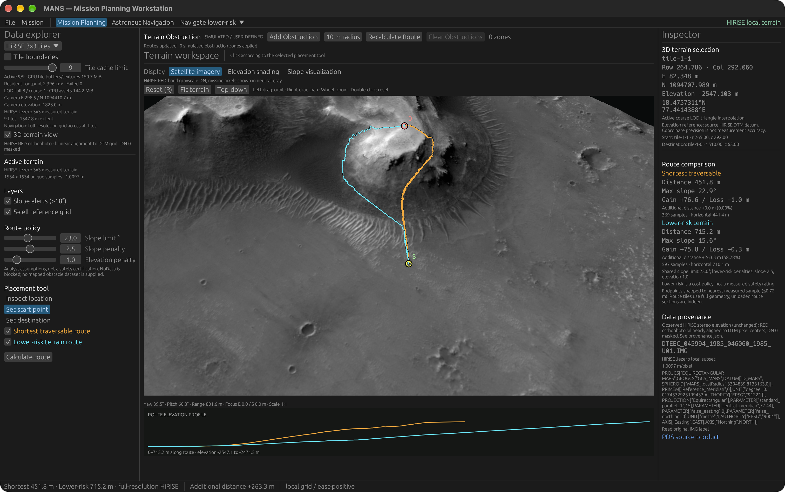
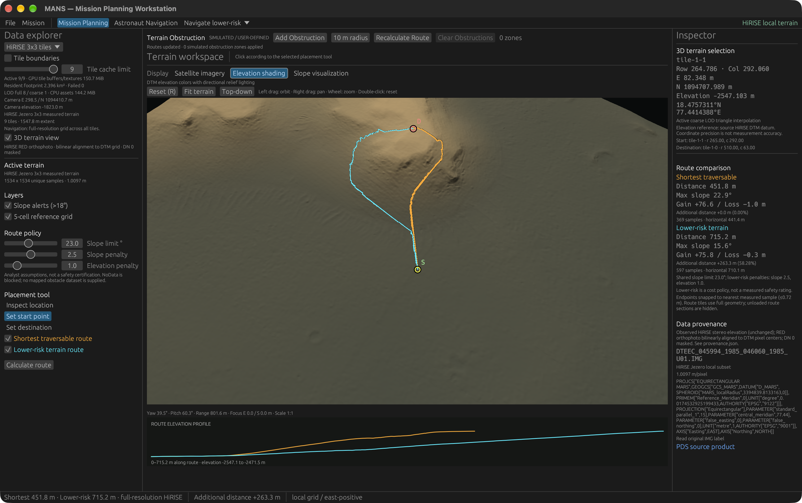
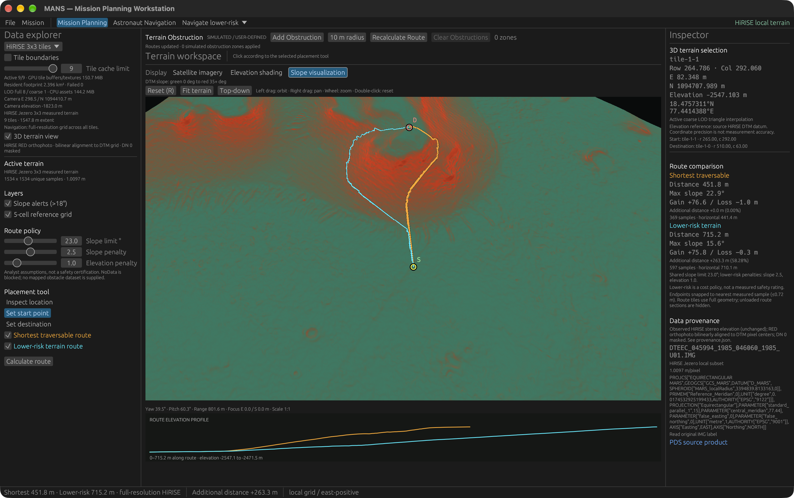
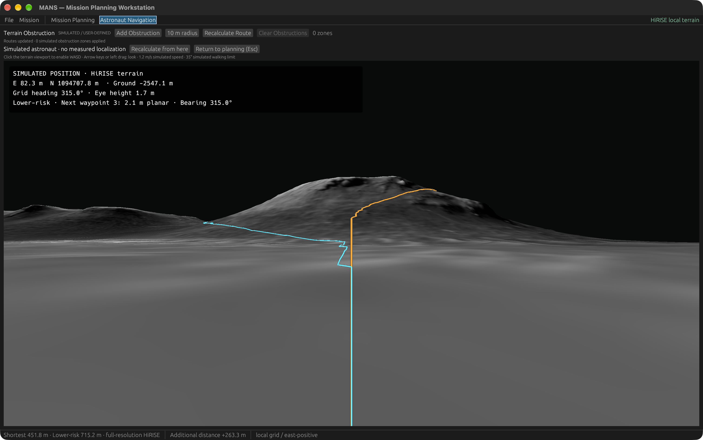
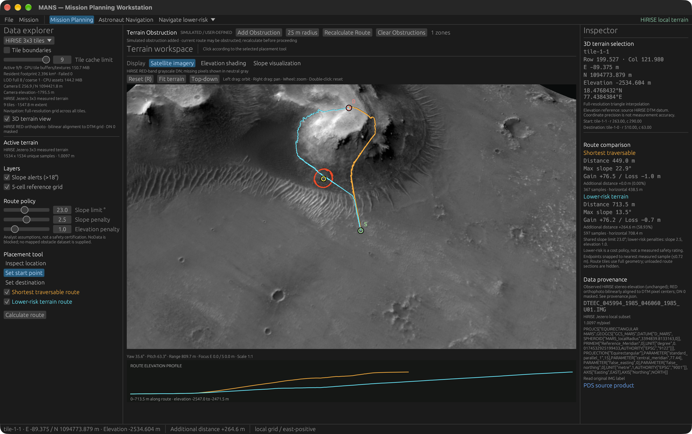
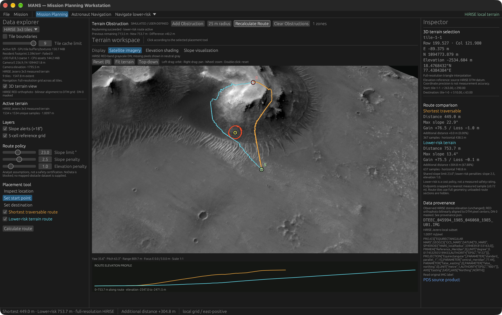

# MANS — Mars Autonomous Navigation System

A local, interactive Jezero Crater navigation concept for the 2026 NASA Space Apps Challenge. This is **educational prototype software, not flight software**.

## Run

Requires Node.js 22+.

```bash
npm install
npm run dev
```

Open the printed local URL. `npm run build` creates a static production bundle in `dist/`; `npm run preview` serves it. The compiled Rust WebAssembly module is already included in `public/wasm`. If WebAssembly cannot load, the app uses the same A* algorithm in TypeScript and labels that fallback in the UI.

To rebuild Rust WebAssembly, install Rust and `wasm-pack`, then run:

```bash
rustup target add wasm32-unknown-unknown
npm run build:wasm
```

## Native macOS workstation

The native workstation uses Rust, `eframe`, and `wgpu` (Metal on macOS). It opens local HiRISE tiled assets when available, with single-patch HiRISE and bundled MOLA available from the dataset menu. Existing 2D A* route tools remain available for the single selected patch.

```bash
DEVELOPER_DIR=/Library/Developer/CommandLineTools cargo build -p mans-desktop
DEVELOPER_DIR=/Library/Developer/CommandLineTools cargo run -p mans-desktop
```

If the active Xcode installation is already configured, `DEVELOPER_DIR` is unnecessary. The architecture and known data limits are recorded in [docs/native-architecture.md](docs/native-architecture.md) and [docs/native-migration-audit.md](docs/native-migration-audit.md).

### Reproducing the observed Jezero terrain sample

For the native multi-tile HiRISE viewer, with the previously downloaded source products in `data/local/`:

```sh
.venv/bin/python tools/nasa-data/generate_hirise_tiles.py
.venv/bin/python tools/nasa-data/test_tile_assets.py
cargo run -p mans-desktop
```

The generator writes `data/local/hirise-tiles/manifest.json` and nine 512×512 tiles. One sample row/column is shared between neighbors (511-cell stride); the region has 1534×1534 unique samples, about 1.548 km per side. Elevation samples, shared-halo normals, valid masks, aligned orthophotos, projected bounds, planetocentric geographic bounds, and source provenance are retained.

The native loader performs file reads, image decoding, mesh generation, and LOD preparation on one worker thread. The GPU cache is configurable from 1–9 resident tiles. Overview loads the nearest tiles within the cache limit; close views load the focus tile and immediate neighbors. Far tiles use a precomputed 4-sample interior spacing while all tile boundary vertices remain at full resolution to avoid cracks. Camera changes reuse both index buffers and textures.

The UI reports resident footprint and estimated bytes for live tile buffers/textures and retained CPU tile assets (including the picking geometry). These are resource accounting values, not total process or driver memory. A single-patch fallback mesh, viewport render targets, route buffers, and the navigation worker's full-resolution grid are additional allocations. Initial LOD has two discrete levels and can visibly change interior detail at the distance threshold; it does not implement geomorphing. Existing 2D route tools remain separate from multi-tile 3D navigation.

In the HiRISE 3×3 dataset, click a loaded surface with Inspect, Set start point, or Set destination. The Inspector reports the tile, fractional zero-based sample row/column, projected easting/northing, elevation in the source DTM datum, and planetocentric latitude/east-positive longitude. Picking intersects the exact uploaded triangles at the active LOD, with block bounds accelerating the search. Elevation is triangle-interpolated from observed vertices; coarse LOD selection is explicitly identified. Unknown geographic projections return unavailable instead of guessed coordinates. Markers remain anchored to the current LOD surface and are hidden behind terrain or when their tile is unloaded. Dragging controls the camera without selecting points.

Press **Calculate route** after selecting 3D endpoints on any two tiles. A background worker merges the nine measured grids into one 1534×1534 navigation grid with shared boundaries stored once, validates matching edge elevations, and retains that grid for subsequent calculations (about 18 MiB of elevations, independent of the GPU tile cache). Endpoints snap to the nearest observed grid sample, at most half a diagonal cell (about 0.714 m); NoData endpoints are rejected. Changing endpoints, policy, or dataset clears stale geometry and cancels pending searches.

The existing Rust A* engine now uses a deterministic binary heap and an admissible, consistent planar octile heuristic. Edge cost is `surface_length * (1 + slope_weight * (slope_degrees / 12)^2) + elevation_weight * absolute_elevation_change`, with elevation weight 1 and configurable slope limit/penalty. These are analyst assumptions, not certified astronaut traversal limits. NoData is always excluded; no independent rock/obstacle map is supplied. Diagonals cannot cut blocked corners. The alternate mesh diagonal is split at the actual facet intersection, so costs, slope checks, route geometry, and measurements follow the same full-resolution surface. A failed search reports an error and never substitutes a straight line.

The cyan 3D route is uploaded only when it changes and rendered in the existing depth-tested GPU pass. Its 6 cm vertical display offset and fixed screen line width are display choices, not a measured corridor. Resident tiles traversed by the route use full-resolution geometry to keep it aligned; unloaded route sections are hidden without altering navigation measurements. The Inspector and distance-based elevation profile show surface length, planar length, cumulative ascent/descent, maximum along-route segment slope, and traversed grid samples. 2D center-patch/MOLA planning remains available separately.

The MOLA regional reference is [data/real/jezero-mola-128.json](data/real/jezero-mola-128.json), a 16 × 16 window centered on 18.444°N, 77.450°E. It is extracted without resampling from NASA MOLA `MEGT44N000HB.IMG`.

```bash
DEVELOPER_DIR=/Library/Developer/CommandLineTools python3 tools/nasa-data/fetch_mola_jezero.py --size 16
```

MOLA samples are roughly 463 m apart at the equator. They support regional terrain interpretation and route-algorithm validation, not astronaut-scale hazard certification. The Inspector shows the original product identifier, coordinate system, vertical datum, sampling and PDS source link.

## Application Screenshots

MANS is a native macOS workstation for exploring NASA HiRISE terrain, comparing traversal policies, and simulating astronaut navigation.

### 3D Terrain & Route Optimization



### Terrain Elevation & Slope Analysis




### Astronaut Navigation Simulation



### Adaptive Route Replanning

A user-defined simulated obstruction changes the planned route. In this example, the remaining route increased from 713.5 m to 753.7 m (+40.2 m).

**Before replanning**



**After replanning**



The terrain is derived from NASA HiRISE observations. Astronaut movement and obstructions are simulated, not real sensor observations.

## What works

- 65 × 65 terrain grid (12 m cells), interactive 3D view, selectable start and destination.
- Rust/WebAssembly A* route planning with elevation-based slope and traversal cost; shortest and safer paths; obstacle exclusion and route recalculation.
- First-person perspective, projected path rings, movement playback, route deviation and remaining-distance readouts.
- A simple constant-velocity position estimator with growing process uncertainty and separate visual-position and one-dimensional simulated radio-range updates.
- Scenarios alter calculations: communication loss removes range updates; visual loss removes visual fixes; high uncertainty increases IMU drift; dust reduces speed and visual-update frequency; obstruction replans around blocked cells.
- Elevation profile and telemetry panel.

Run algorithm tests with `npm test` and `npm run test:rust`.

## Data provenance

The bundled terrain is **procedurally simulated** and merely resembles Jezero morphology. A copy is in `data/sample-terrain.json`. Its elevations, weather values, obstacles, radio link and movement do not come from NASA observations. The local coordinate labels use a simple approximation anchored at 18.444°N, 77.450°E with planetocentric latitude and positive-east longitude. No claim of metre-level geolocation is made.

For observed topography, see [data/README.md](data/README.md). The reproducible Rasterio script crops a user-supplied USGS HiRISE/CTX DTM GeoTIFF to the exact local grid. The browser loads `public/data/terrain.json` if generated and marks its terrain as USGS-derived. No large NASA dataset is bundled. MOLA is too coarse for this particular route grid. MEDA and NAIF SPICE are documented as future integrations but are **not** ingested or represented as real-time data here.

The route slope is derived from the terrain grid, not an independent sensor observation. The position covariance is diagonal and omits heading uncertainty, cross-correlation, terrain registration uncertainty and rover/astronaut dynamics. The radio update is deliberately weak and one-dimensional; a visible communication link never acts as a GPS fix. Do not use any route or warning for real mission safety decisions.

## Structure

- `src/nav.ts` — grid calculations, TypeScript fallback, estimator and local coordinate display.
- `crates/mans-nav` — tested Rust A* engine compiled to WebAssembly.
- `apps/desktop` — native macOS planning workstation using the same Rust engine.
- `src/TerrainScene.tsx` — Three.js terrain and route visualization.
- `src/store.ts` — mission controls and scenario state.
- `src/App.tsx` — playback, sensor simulation and mission-control interface.
- `data/prepare_terrain.py` — observed DTM crop and provenance metadata.
- `tools/nasa-data/fetch_mola_jezero.py` — reproducible NASA PDS MOLA Jezero extractor using byte-range requests.


## AI Assistance Disclosure

OpenAI ChatGPT and Codex were used to assist with project planning, technical consultation, software implementation, debugging, code improvement and optimization, data analysis, and technical writing and translation. The team directed the development process, made design decisions, and reviewed and tested the implementation.
